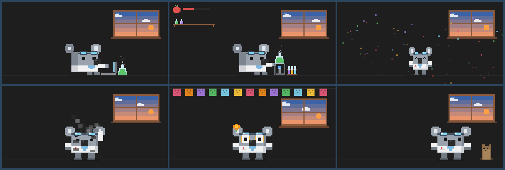
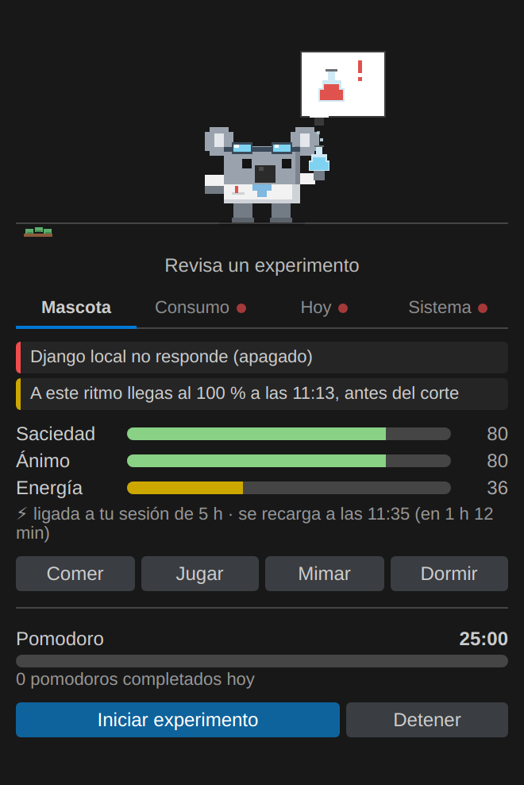
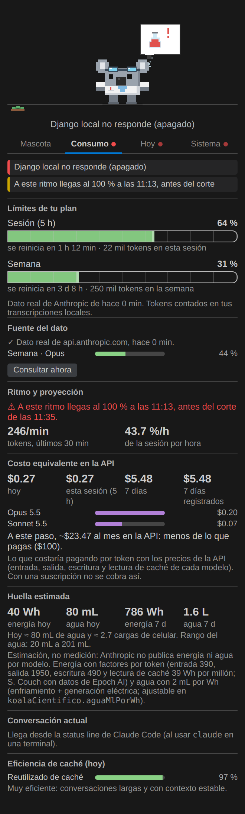
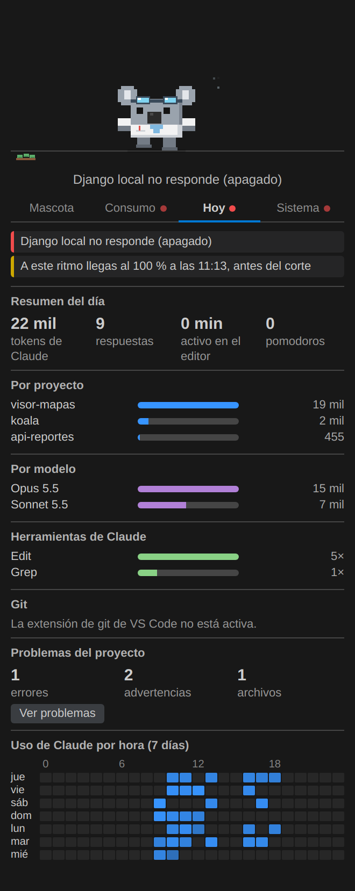
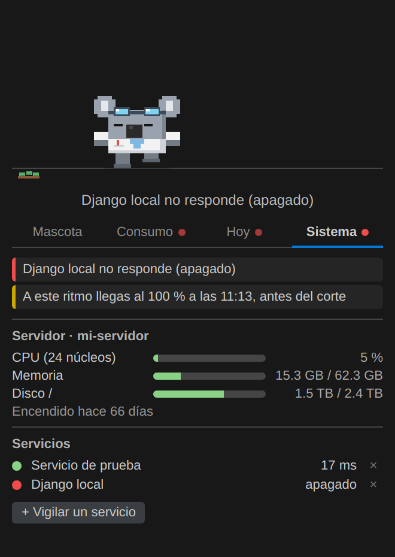

# Koala científico 🐨🧪

Mascota de laboratorio en pixel art para el Explorador de VS Code. Trabaja contigo (editor,
terminal y Claude Code), festeja tus commits, te avisa cuando Claude te necesita y funciona como
**mini monitor** de tu consumo de Claude Code: límites de **sesión (5 h)** y **semana**, ritmo,
costo equivalente, pomodoro, git y servidor.

| Mascota | Consumo | Hoy | Sistema |
|---|---|---|---|
|  |  |  |  |

*Capturas con datos de demostración.*

## Empezar
1. Instala la extensión y abre el Explorador → **Koala científico**.
2. Acepta **conectar con Claude Code** cuando te lo ofrezca (o ejecuta *Koala científico:
   configurar monitor de Claude Code*). Necesita Python 3.
3. Opcional: en la pestaña **Consumo**, *Usar dato directo de Anthropic*.

La mascota, el pomodoro y las pestañas Hoy y Sistema funcionan sin configurar nada.

## Privacidad
Todo se queda en tu computadora salvo lo que actives tú:
- **Clima (desactivado por omisión)**: solo si eliges una ciudad; se consultan Open-Meteo con ese nombre
  y sus coordenadas cada 15 min. No se usa tu IP ni tu ubicación.
- Lee tus transcripciones de Claude Code (`~/.claude/projects`) **solo para contar tokens**,
  modelos, herramientas y horas; no lee ni envía el contenido de las conversaciones.
- *Configurar monitor* agrega a `~/.claude/settings.json` una status line y hooks (con respaldo
  previo). Escriben dos archivos locales: `~/.claude/koala-uso.json` y `~/.claude/koala-estado.json`.
- **Dato directo de Anthropic (desactivado por omisión)**: usa el token de la sesión de Claude Code
  de tu equipo para consultar `api.anthropic.com/api/oauth/usage`. El token solo viaja a Anthropic;
  no se muestra ni se registra.
- **Servicios vigilados**: solo las direcciones que tú agregas.
- Sin telemetría ni analítica de ningún tipo.

Proyecto independiente: no está afiliado a Anthropic. "Claude" es una marca de Anthropic.

## Monitor de Claude Code
- **Porcentaje oficial**: Claude Code entrega `rate_limits` a su *status line*. El script
  `koala-statusline.py` lo guarda en `~/.claude/koala-uso.json` y el koala lo lee.
- **Tokens locales**: el koala suma los tokens de tus transcripciones
  (`~/.claude/projects/**/*.jsonl`) dentro de cada ventana. Sirve aunque no haya dato oficial.
- **Turnos**: los hooks `UserPromptSubmit`, `PreToolUse` y `Stop` escriben
  `~/.claude/koala-estado.json`; el koala se sienta a trabajar mientras Claude trabaja.

Configúralo con **Koala científico: configurar monitor de Claude Code** (respalda
`~/.claude/settings.json` antes de cambiarlo). El porcentaje se actualiza cada vez que
Claude Code pinta su status line.

A partir de 75 % el matraz se pone ámbar y el koala suda; al llegar a
`koalaCientifico.avisarEnPorcentaje` (90 %) se pone rojo y te avisa una vez por ventana.
Cuando la ventana se reinicia, baila.

## Energía = tu sesión de Claude Code
Con dato oficial, la energía del koala es lo que te queda de la sesión de 5 h (100 − % usado) y se
recarga sola en el corte; el panel dice a qué hora. Si se agota, duerme hasta el corte (o hasta que
vuelvas a trabajar). Sin dato oficial usa su energía de tamagotchi.

## Pomodoro (experimentos)
Botón **Iniciar experimento** o comando *Koala científico: iniciar / pausar pomodoro*. Durante el
enfoque el koala monta su mesa (mechero, matraz y tubos) y experimenta; en el descanso se relaja y
al completar un pomodoro festeja. Reloj en el panel, en el lienzo y en la barra de estado (clic para
pausar). Duraciones en `koalaCientifico.pomodoro.*` (25/5/15, descanso largo cada 4).

## Mini monitor (pestañas)
- **Consumo**: límites de 5 h y semana; ritmo de los últimos 30 min y a qué hora llegarías al 100 %
  (¿antes o después del corte?); conversación actual (contexto, costo equivalente en USD, líneas
  cambiadas, duración); eficiencia de caché.
- **Hoy**: tokens, respuestas, tiempo activo y pomodoros; tokens por proyecto y por modelo;
  herramientas que usó Claude; git (rama, cambios sin commit, commits de hoy); errores y
  advertencias del proyecto; mapa de calor de uso por hora (7 días).
- **Sistema**: CPU, memoria y disco del servidor; servicios vigilados cada minuto
  (`koalaCientifico.servicios` o botón *+ Vigilar un servicio*), con aviso si se caen o vuelven.
- **Alertas**: las más importantes salen arriba, con un punto rojo en su pestaña; el koala las dice.

## Dato directo de Anthropic (opcional)
Botón **Usar dato directo de Anthropic** (pestaña Consumo) o `koalaCientifico.usoDesdeAnthropic`:
consulta `GET https://api.anthropic.com/api/oauth/usage` cada 5 min con el token OAuth que Claude
Code guarda en `~/.claude/.credentials.json`. Da el % real de sesión, semana y ventanas por modelo
(p. ej. *Semana · Opus*). El token solo se envía a Anthropic, no se muestra ni se registra, y no se
renueva aquí (Claude Code lo renueva al usarlo). Es un endpoint no documentado: puede cambiar.

## Costo y huella
- **Costo equivalente**: cada respuesta de tus transcripciones se valora con los precios de la API
  de su modelo (entrada, salida, escritura de caché 1.25×/2× y lectura de caché). Hoy, sesión,
  7 y 30 días, por modelo y proyección mensual; con `koalaCientifico.costoPlanMensualUSD` lo
  compara con lo que pagas.
- **Huella estimada** (energía y agua): factores por token de S. Couch (con datos de Epoch AI) y
  `koalaCientifico.aguaMlPorWh` (2 mL/Wh por omisión). Anthropic no publica estos datos: es un
  orden de magnitud.

## Festejos de git
Con cada **commit** (tuyo o de Claude, en cualquier repositorio abierto) cae confeti y el koala
baila con el mensaje del commit; con cada **push** lanza un cohete. Cada uno sube el ánimo. Un
`pull` de commits ajenos no cuenta.

## Avisos de Claude y de la terminal
- **Claude te necesita** (hook `Notification`): levanta la mano con un "?" y llega una notificación
  con lo que pide (p. ej. "permiso para usar Bash"). Se baja la mano cuando Claude sigue.
- **Claude terminó** un turno de 2 min o más: trae un papel de "¡listo!" con la duración (la
  notificación solo sale si VS Code no tiene el foco).
- **Comandos** de pruebas, builds o migraciones (o de 15 s o más): si pasan, matraz verde y aplauso;
  si fallan, el matraz explota y queda tiznado. Requiere la integración de shell de VS Code.

## Más reacciones
- **Errores en cero**: si arreglas el último error del proyecto, barre con escoba y aplaude.
- **Servicio caído**: corre con el extintor; cuando vuelve a responder, aplaude.
- **Racha de commits** (días seguidos con commits tuyos): medallas en la bata a los 3 (bronce),
  7 (plata) y 14 días (oro); el commit la presume y de tarde te recuerda no romperla.
- **Reloj de arena**: los últimos 10 min antes del corte de la sesión (si llevas 60 % o más).
- **Hora del día**: de noche gorro de pijama y lámpara; de 6 a 10 h toma café; viernes por la
  tarde baila más.
- **Siesta**: tras `koalaCientifico.minutosParaSiesta` (20) sin actividad se duerme sobre la
  laptop; al volver despierta sobresaltado.
- **Arrastrar**: carga al koala con el mouse y suéltalo (cae aplastado); arrastra la rama de la
  esquina para darle de comer donde la sueltes. Un clic sin arrastrar lo mima.

## El laboratorio a lo largo del día
- **Ventana**: el cielo cambia con la hora (amanecer, día, atardecer, noche con luna y estrellas).
- **Clima y termómetro**: con *Koala científico: elegir ciudad del clima* (o el botón de la pestaña
  Sistema) escribes tu ciudad y la escoges de una lista. La ventana muestra el clima real (nubes, lluvia,
  tormenta, nieve, niebla), el termómetro junto a ella marca la temperatura de afuera y el koala saca
  paraguas, se abanica o se pone bufanda. Usa Open-Meteo (gratis, sin cuenta; necesita internet). **El
  koala no detecta tu ubicación**: solo usa la ciudad que tú eliges. La temperatura del CPU está en Sistema.
- **Rutina**: buenos días con café y un resumen (semana de Claude, racha, cambios pendientes); hora de
  la comida; **pausa activa** tras `koalaCientifico.minutosPausaActiva` (90) min seguidos; despedida al
  final del día con lo que hiciste.
- **Agua**: botón 💧 en la pestaña Mascota y meta diaria (`koalaCientifico.metaAgua`).
- **Estante** con un matraz por cada pomodoro del día.
- **Logros**: 14 medallas en la pestaña Hoy (primer pomodoro, rachas, 100 commits, madrugador,
  noctámbulo, código impecable…).
- **Ánimo del código**: sonríe solo tras días sin errores; se pone nervioso con 20 o más cambios sin commit.
- **Visitantes** (`koalaCientifico.visitantes`): de vez en cuando un panda, un ajolote o un tlacuache
  pasan por el piso o por la ventana y se saludan.
- **Sonidos** (`koalaCientifico.sonidos`, apagados por omisión): al terminar Claude o un pomodoro, al
  festejar un commit, al desbloquear un logro.

## Temporadas y fechas
| Fecha | El koala… |
|---|---|
| 31 dic. – 1 ene. | gorro de fiesta y fuegos artificiales |
| 6 ene. | corona; come rosca de Reyes |
| 2 feb. | la marmota sale a ver su sombra; Candelaria: come tamales |
| 14 feb. | moño rosa y corazones |
| 14 mar. | pizarrón con π (Día de Pi) |
| 20–21 mar. | flores y mariposa (primavera) |
| 30 abr. | gorro de fiesta y globos (Día del Niño) |
| 10 may. | flor en la oreja y florero (Día de las Madres) |
| día 256 | lluvia de ceros y unos (Día del Programador) |
| 13–16 sep. | moño tricolor |
| 12 oct. | globo terráqueo (Día de la Nación Pluricultural) |
| 28 oct. – 2 nov. | catrina, cempasúchil y papel picado |
| 12 dic. – 6 ene. | gorro de Navidad |
| tu cumpleaños | pastel con velas, gorro y confeti (`koalaCientifico.cumpleanos` = `DD/MM`) |

`koalaCientifico.temporada` fuerza cualquiera de ellas para verla cuando quieras.

## Tamagotchi
Saciedad, ánimo y energía (se guardan entre sesiones). Comer (eucalipto), jugar (pelota),
mimar (o clic sobre él) y dormir. Si le pides algo mientras trabaja, guarda la laptop,
lo hace y vuelve a trabajar.

## Ajustes
`koalaCientifico.segundosParaDescansar`, `koalaCientifico.reaccionarAClaude`,
`koalaCientifico.avisarEnPorcentaje`, `koalaCientifico.barraDeEstado`.

## Instalar
1. Descarga `koala-cientifico-X.Y.Z.vsix`.
2. En VS Code: Extensiones → menú `…` → **Instalar desde VSIX…** (o `code --install-extension archivo.vsix`).
3. Abre el Explorador → **Koala científico**.
4. Para el % de Claude Code: comando **Koala científico: configurar monitor de Claude Code**.
   Requiere Python 3 (`python3`; en Windows, `python`). Si usas Claude Code por SSH, instala la
   extensión en el remoto (corre donde está `~/.claude`).

## Llevarlo a otra computadora
1. Copia el `.vsix` (en VS Code: clic derecho sobre el archivo → *Descargar…*; o por correo/USB).
2. En la otra computadora: Extensiones → `…` → **Instalar desde VSIX…**.
3. Al abrir VS Code el koala ofrece **conectarse con Claude Code** (una sola vez); acepta.
   Necesita Python 3 (`python3`, `python` o `py`); si no está, te lleva a descargarlo.
4. Opcional: activa el dato directo de Anthropic en la pestaña Consumo.

Funciona en Linux, Windows y macOS (en macOS la sesión de Claude se lee del llavero: la primera vez
macOS pide permiso). Con **Settings Sync** de VS Code, el ánimo, la saciedad y la energía del koala
te siguen entre computadoras; el resto (pomodoros, tiempo activo, consumo) es de cada máquina.
Si usas Claude Code por SSH, instala la extensión en el remoto (corre donde está `~/.claude`).

## Licencia
MIT. Código en https://github.com/JJAS-029/koala_monitor.

## Desarrollo
- Pruebas sin navegador: `node pruebas/simular.js [carpeta]` (capturas PNG por acción).
- Vista previa real del panel: `pruebas/vista-previa.js` (activa la extensión con un VS Code simulado
  y captura cada pestaña con Chromium sin interfaz; ver el encabezado del archivo).
- Icono: `node pruebas/icono.js`. Capturas del readme: `node pruebas/capturas-readme.js` y
  `pruebas/datos-demo.js` (transcripciones ficticias) con `DEMO=1` en la vista previa.
- Paquete para la tienda: `npx @vscode/vsce package` (respeta `.vscodeignore`).
- Paquete: `python3 empaquetar.py` → `.vsix`; instalar con `code --install-extension <vsix> --force`.
